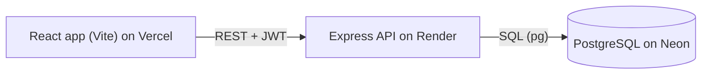

# EventGate

**QR-based event registration and check-in for college clubs.**
Students discover events and get a QR ticket. Organizers scan tickets with a phone camera at the gate, watch attendance update live, and export the attendance report as CSV.

**Live demo:** https://event-gate-nine.vercel.app
**API health check:** https://eventgate-api-dm6v.onrender.com/api/health

> **Note on the live demo:** the API runs on a free hosting plan that goes to sleep after about 15 minutes without visitors. The first load after a quiet period can take up to a minute. The site shows a "Waking up the server" bar while it waits.
>
> To look around, create your own account: choose **Student** to browse and register, or **Organizer** to create events and scan tickets.

---

## The problem

Club events are usually run with Google Forms and paper attendance sheets. That leads to duplicate entries, overbooked rooms, fake sign-ups, and slow queues at the gate. EventGate replaces this with one flow:

1. An organizer creates an event with a seat limit.
2. A student registers and receives a QR ticket.
3. A volunteer scans the QR code at the venue and the student is marked present, once only.
4. The organizer sees who has arrived, live, and downloads the report.

## Features

**Students**
- Event discovery page with search and an "upcoming only" filter
- Live seat counts, with "Sold out", "Only N seats left" and "Event ended" states
- One-tap registration, with duplicate registration and overbooking prevented
- QR ticket page that updates by itself to "Checked in" after the gate scan
- My tickets list and registration cancellation (until checked in)

**Organizers**
- Dashboard with totals for events, registrations and check-ins
- Create, edit and delete events (seat limit cannot drop below current registrations)
- Camera-based QR scanner with manual ticket-code entry as a fallback
- Clear scan results: checked in, already checked in, wrong event, unknown ticket
- Live attendance page (refreshes every 5 seconds) with searchable attendee list
- CSV export of the attendance report

**Platform**
- Email and password accounts with two roles (student, organizer)
- Loading, empty and error states on every page, responsive layout
- 33 automated API tests, including concurrency tests

## Tech stack

| Layer | Technology |
|---|---|
| Frontend | React 19, Vite, Tailwind CSS v4, React Router, `qrcode.react`, `@yudiel/react-qr-scanner` |
| Backend | Node.js, Express, `pg`, `bcryptjs`, `jsonwebtoken`, Helmet, `express-rate-limit`, CORS |
| Database | PostgreSQL (hosted on Neon), plain SQL, no ORM |
| Testing | Vitest, Supertest |
| Hosting | Vercel (website), Render (API), Neon (database) |

## Architecture



- The React app talks to the API over REST and sends a JWT in the `Authorization` header.
- The API checks the token, the user's role, and (for organizer actions) that the event belongs to that organizer.
- All business rules live on the server. The React route guards only decide what to show.
- The QR code contains only the ticket code. The server looks up the student and event.

### Database

Three tables:

| Table | Key columns and rules |
|---|---|
| `users` | `id`, `name`, `email` (unique), `password_hash`, `role` (`student` or `organizer`) |
| `events` | `id`, `organizer_id` (FK, cascade delete), `title`, `description`, `venue`, `event_date`, `seat_limit` (must be > 0) |
| `registrations` | `id`, `user_id` (FK), `event_id` (FK), `ticket_code` (unique), `checked_in_at`; **unique (`user_id`, `event_id`)** |

Indexes: `registrations(event_id)`, `events(organizer_id)`, `events(event_date)`.
The schema is in [`server/src/schema.sql`](server/src/schema.sql) and is applied with `npm run migrate`.

### API

All routes are under `/api`. "Auth" means a valid JWT is required.

| Method and path | Who | Purpose |
|---|---|---|
| `GET /health` | public | Server and database check |
| `POST /auth/register` | public | Create an account |
| `POST /auth/login` | public | Log in, returns a JWT |
| `GET /auth/me` | auth | Current user |
| `GET /events?q=&upcoming=` | auth | Search and list events with seat counts |
| `GET /events/mine` | organizer | The organizer's own events with counts |
| `GET /events/:id` | auth | One event |
| `POST /events` | organizer | Create an event |
| `PUT /events/:id` | event owner | Edit an event |
| `DELETE /events/:id` | event owner | Delete an event (and its registrations) |
| `POST /registrations` | student | Register for an event, returns a ticket |
| `GET /registrations/mine` | student | The student's tickets |
| `GET /registrations/:id` | ticket owner | One ticket |
| `DELETE /registrations/:id` | ticket owner | Cancel (not allowed after check-in) |
| `POST /checkin` | event owner | Check in a ticket code for an event |
| `GET /events/:id/attendance` | event owner | Attendance report (JSON) |
| `GET /events/:id/attendance.csv` | event owner | Attendance report (CSV download) |

## Key engineering decisions

**Last-seat race.** If one seat is left and two students tap Register at the same moment, both must not succeed. Registration runs in a database transaction that locks the event row (`SELECT ... FOR UPDATE`), counts the seats, then inserts. Requests for the same event queue up one at a time. A unique constraint on (`user_id`, `event_id`) is a second safety net against duplicate registrations.

**Check-in only once.** Check-in is a single atomic statement: `UPDATE registrations SET checked_in_at = NOW() WHERE ticket_code = $1 AND event_id = $2 AND checked_in_at IS NULL`. If two scans of the same ticket arrive together, only one can match the empty `checked_in_at`. The other gets "already checked in". The server then runs a lookup to give a precise reason (unknown ticket, wrong event, already used).

**Authorization on the server.** Role checks and ownership checks run on every protected route. For example, another organizer cannot edit your event, read its attendance, or check people in to it.

**Security basics.**
- Passwords hashed with bcrypt, never stored in plain text
- JWT with a 7-day expiry, secret kept in an environment variable
- Login and register rate-limited (60 requests per 15 minutes per address)
- Helmet security headers, request body size limit, CORS limited to the website's own address
- Parameterized SQL queries everywhere (no string-built SQL)
- CSV export neutralises cells that start with `=`, `+`, `-` or `@` so a malicious name cannot run as a spreadsheet formula
- The login error message is the same for "no such email" and "wrong password"

**Near-real-time updates without WebSockets.** The ticket page and the attendance page ask the server every 5 seconds (polling). This is simple, robust and easy to reason about. The trade-off is up to 5 seconds of delay and some repeated requests.

**Plain SQL, no ORM.** The queries are written by hand, so every join, lock and constraint is visible.

## Testing

The automated test suite (Vitest + Supertest) has 33 tests covering:
- Accounts, login, token checks and malformed input
- Role and ownership rules (students and other organizers are refused)
- Event validation and seat-limit rules
- Registration rules: duplicates, full events, cancellation
- **Race conditions:** five students registering at once for a single seat produce exactly one ticket; two simultaneous scans of one ticket produce exactly one success
- Check-in outcomes, attendance report and CSV formula protection

```bash
cd server
npm test
```

The tests run against the database in `DATABASE_URL`. Every account they create uses an `@eventgate-test.local` email and is deleted at the end (events and registrations are removed with them). For extra safety, point `DATABASE_URL` at a separate Neon branch or database when running tests.

## Run it locally

**Prerequisites:** Node.js 20.19 or newer (22 recommended), Git, and a PostgreSQL database. A free [Neon](https://neon.tech) project works well.

### 1. Clone

```bash
git clone https://github.com/MADHU270803/EventGate.git
cd EventGate
```

### 2. Start the API

```bash
cd server
npm install
```

Create `server/.env` from the example and fill it in:

```powershell
Copy-Item .env.example .env
```

| Variable | Meaning |
|---|---|
| `DATABASE_URL` | PostgreSQL connection string (for Neon, it ends in `?sslmode=require`) |
| `JWT_SECRET` | A long random string. Generate one with `node -e "console.log(require('crypto').randomBytes(32).toString('hex'))"` |
| `CLIENT_URL` | The website address allowed to call the API, no trailing slash. Locally: `http://localhost:5173` |
| `PORT` | API port. Default `5000` |

Create the tables and start the server:

```bash
npm run migrate
npm run dev
```

Open http://localhost:5000/api/health. You should see `{"status":"ok", ...}`.

### 3. Start the website

In a second terminal:

```bash
cd client
npm install
```

```powershell
Copy-Item .env.example .env
```

`client/.env` needs one variable: `VITE_API_URL=http://localhost:5000/api`.

```bash
npm run dev
```

Open http://localhost:5173.

> The camera scanner works on `localhost` and on HTTPS sites only. This is a browser rule. To try it on a phone, use the deployed site.

## Deployment

| Part | Service | Settings |
|---|---|---|
| Database | Neon | Free Postgres project. Run `npm run migrate` against it once. |
| API | Render (Web Service) | Root directory `server`, build `npm install`, start `npm start`. Environment: `DATABASE_URL`, `JWT_SECRET`, `CLIENT_URL` (the Vercel address), `NODE_VERSION=22`. Health check path `/api/health`. |
| Website | Vercel | Root directory `client`, Vite preset. Environment: `VITE_API_URL` (the Render address plus `/api`). `client/vercel.json` rewrites every path to `index.html` so refreshing a page like `/organizer` works. |

Use a different `JWT_SECRET` in production than on your laptop.

## Project structure

```
EventGate/
├── client/                     React website
│   ├── src/
│   │   ├── api.js              fetch wrapper, token storage, CSV download
│   │   ├── context/            AuthContext (login state)
│   │   ├── components/         Layout, route guards, EventCard, UI pieces
│   │   └── pages/              Login, Register, Discover, MyTickets, TicketPage,
│   │                           OrganizerDashboard, EventForm, Attendance, ScanPage
│   └── vercel.json
└── server/                     Express API
    └── src/
        ├── app.js              middleware, routes, error handling
        ├── index.js            starts the server
        ├── db.js               PostgreSQL connection pool
        ├── schema.sql          tables and indexes
        ├── migrate.js          applies schema.sql
        ├── middleware/auth.js  JWT check and role check
        ├── routes/             auth, events, registrations, attendance
        └── tests/api.test.js   automated API tests
```

## Known limitations and ideas for the future

- **Anyone can register as an organizer.** There is no approval step. A real deployment would need organizers to be approved by an admin.
- **No email verification or password reset.**
- **The JWT is stored in `localStorage`.** This is simple, but a cross-site scripting bug could expose it. Production systems often use HTTP-only cookies with refresh tokens.
- **Polling, not WebSockets.** Live updates can lag by up to 5 seconds.
- **Volunteers use organizer accounts.** There is no separate "gate staff" role limited to scanning one event.
- **No pagination.** The event list and attendee table load everything, which is fine for club-sized events but not for thousands of rows.
- **Times are shown in Indian Standard Time.** There is no per-user time zone setting.
- **Free hosting sleeps when idle,** so the first request after a quiet period is slow.
- **Tests share the real database** (with cleanup) instead of using a dedicated test database.

## Author

**Madhumitha Y**: Integrated M.Tech Software Engineering student at VIT.
[GitHub](https://github.com/MADHU270803) · [LinkedIn](https://www.linkedin.com/in/madhumitha-y-255523255)
